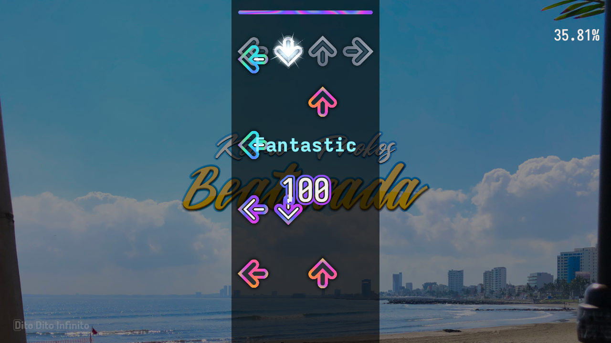

<h1><a href="https://sugoijan.dev/ditoditoinfinito/"><picture>
  <source media="(prefers-color-scheme: dark)" srcset="docs/logo.svg">
  
</picture></a></h1>

<picture>
  <source srcset="docs/screenshots/readme.avif" type="image/avif">
  
</picture>

> Song: Beatucada by Kurio Prokos · Chart: by Timo Kitsune · Background: by Jose Varela.

A dance rhythm game that works on the web. Alternative to StepMania, ITGmania, Etterna and others.

## Develop and build

Prerequisites:

- Rust (stable) with the wasm target: `rustup target add wasm32-unknown-unknown`
- [Trunk](https://trunkrs.dev/): `cargo install trunk --locked`
- [just](https://github.com/casey/just) (task runner)
- [uv](https://docs.astral.sh/uv/) (runs the `reuse` linter via `uvx`)

Tasks (`just --list` shows them all):

- `just dev` — local dev server (`trunk serve`)
- `just build` — release build with the production public URL; output in `dist/`
- `just check` — native + wasm checks, SEO regen, REUSE lint
- `just test` — native unit tests
- `just animation` — regenerate the small gameplay GIF above (also requires
  FFmpeg on `PATH`)
- `just screenshot` — regenerate the full-size still, offscreen on a
  fixed clock (requires a GPU; no window or sound device)
- `cargo run` — the desktop app (`--profile desktop` for a fast build; add
  song folders under Options; on Linux it builds against ALSA and udev:
  `libasound2-dev`, `libudev-dev`)

Generated files: `cargo run -p xtask -- gen-songs` writes `target/songs/index.json`
from `assets/songs/*/PROVENANCE.toml`; `gen-noteskins` writes the bundled
noteskins' index; `gen-credits` writes `credits/CREDITS.md` (checked in, CI verifies it)
and `target/credits/credits.json`. Trunk runs them before every build, `just
test` the first two. Gameplay URLs: `#/play?song=<id>&chart=<n>` plus `&auto=1` for autoplay and
`&gfx=gl` to force WebGL2.

Workspace layout: the Rust crates live in `crates/`: `chart/` (chart model and
importers), `engine/` (deterministic gameplay core), `session/` (a play, for both
shells), `library/` (packs, zips, the import's core), `render/` (wgpu scene),
`actor/`, `ui/` and `theme/` (the screens), `noteskin/` and `lua/` (StepMania
noteskins), `platform/` (platform traits, decoders), `app/` (the game: the web
shell on wasm, the desktop shell natively), `web/` (web shell), `desktop/`
(desktop shell). Beside them: `site/` (the web page Trunk builds), `video/` (the
movie decoder), `tools/` (the DanOni importer), `xtask/` (SEO fragments, song
manifest, credits). `AGENTS.md` has more.

## Bundled songs

The demo songs under `assets/songs/` come from
[OutFox Serenity](https://github.com/TeamRizu/OutFox-Serenity) and are used
under CC BY and CC BY-SA licences; see [`credits/CREDITS.md`](credits/CREDITS.md) for the full
attribution and `assets/songs/*/PROVENANCE.toml` for the pinned source commits.
Only songs whose music, charts and graphics each carry an explicit free licence
in the upstream files are included.

## Licence

Code is MIT. Bundled demo songs are third-party Creative Commons works with
their own authors and licences, tracked in `REUSE.toml` and `credits/CREDITS.md`.
