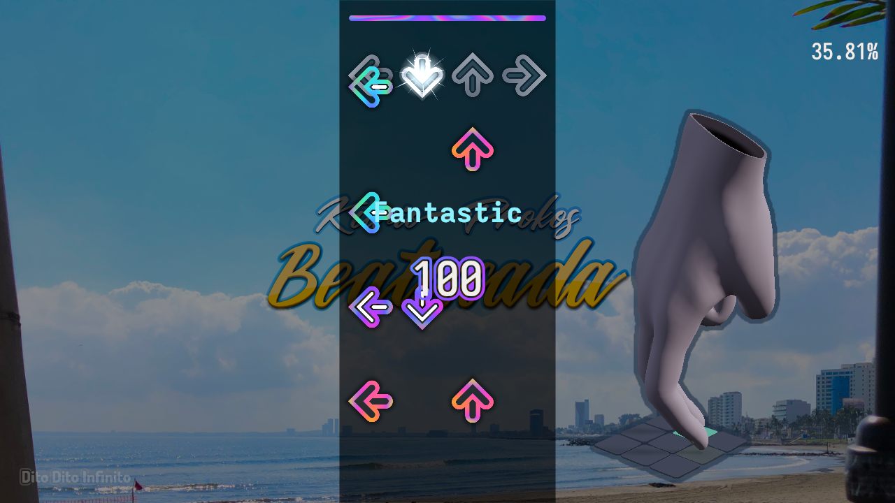

<h1><a href="https://sugoijan.dev/ditoditoinfinito/"><picture>
  <source media="(prefers-color-scheme: dark)" srcset="docs/logo.svg">
  
</picture></a></h1>

<picture>
  <source srcset="docs/screenshots/readme.avif" type="image/avif">
  
</picture>

> Song: Beatucada by Kurio Prokos · Chart: by Timo Kitsune · Background: by Jose Varela.

A dance rhythm game with a battle mode where everyone plays the same song at once and attacks each other until one is left. Play it on the web, alone or with people you invite to a private room. The same game runs as a desktop app built from source; there is no packaged release yet. Alternative to StepMania, ITGmania, Etterna and others.

## Develop and build

Prerequisites:

- Rust (stable) with the wasm target: `rustup target add wasm32-unknown-unknown`
- [Trunk](https://trunkrs.dev/): `cargo install trunk --locked`
- [just](https://github.com/casey/just) (task runner)
- [uv](https://docs.astral.sh/uv/) (runs the `reuse` linter via `uvx`)

Tasks (`just --list` shows them all):

- `just dev` — local dev server (`trunk serve`)
- `just build` — release build with the production public URL; output in `dist/`
- `just check` — native + wasm checks, SEO regen, REUSE lint
- `just test` — native unit tests
- `just l10n-check` — every language has every message
- `just screenshot` — regenerate the gameplay animation above
  (`docs/screenshots/readme.avif`), offscreen on a fixed clock (requires
  a GPU and FFmpeg with SVT-AV1 on `PATH`; no window or sound device).
  The still beside it, `readme.png`, has a scenario of its own:
  [`docs/screenshots/README.md`](docs/screenshots/README.md) says how
  both are made
- `just package` — build the desktop app and package it for this system
  into `target/dist/`
- `cargo run` — the desktop app (`--profile desktop` for a fast build; add
  song folders under Options). Its default build also builds FFmpeg for
  the movie decoder's helper (not on Windows) and, on macOS and x86_64 Linux, the
  Dancing☆Onigiri URL importer's helper (a JDK, CMake and Python 3.11+);
  `--no-default-features` leaves both out. On Linux it builds against
  ALSA, udev and OpenSSL: `libasound2-dev`, `libudev-dev`, `libssl-dev`

Generated files: `cargo run -p xtask -- gen-songs` writes `target/songs/index.json`
from `assets/songs/*/PROVENANCE.toml`; `gen-noteskins` and `gen-announcers`
write the bundled noteskins' and announcers' indexes; `gen-credits` writes
`credits/CREDITS.md` and `credits/THIRD_PARTY_RUST.md` (checked in, CI
verifies them) and `target/credits/credits.json`. Trunk runs them before
every build, `just test` the first three. Gameplay URLs: `#/play?song=<id>&chart=<n>` plus `&auto=1` for autoplay and
`&gfx=gl` to force WebGL2.

Workspace layout: the Rust crates live in `crates/`:

- the game: `chart/` (chart model and importers), `engine/` (deterministic
  gameplay core, rulesets, the CPU player), `session/` (a play, for both
  shells), `shell/` (what both shells share between the settings and the
  renderer), `library/`
  (packs, zips, the import's core, announcers), `render/` (wgpu scene),
  `actor/`, `ui/`, `theme/` and `l10n/` (the screens and their languages),
  `noteskin/` and `lua/` (StepMania noteskins and their sandboxed Lua),
  `platform/` (platform traits, decoders);
- multiplayer: `room/` (the room, match and stage model, shared with the
  private server), `share-protocol/` (songs shared by link), `chat/` (a
  room host's Twitch chat);
- chart ratings: `msd/` (Etterna's MSD for four keys), `rating/` (the
  game's own difficulty estimate);
- the dancing hand: `character/`, `hand-plan/`, `hand-pose/`,
  `dance-mat/`;
- the shells: `app/` (the game: the web shell on wasm, the desktop shell
  natively), `web/` (web shell), `desktop/` (desktop shell), and the web's
  workers `opus-worker/`, `svg-worker/` and `msd-worker/`;
- build support: `icon/` (the app icon), `importer-protocol/` (the
  desktop's DanOni importer helper's messages).

Beside them: `site/` (the web page Trunk builds), `video/` (the movie
decoder), `tools/` (the DanOni importer and SDK, packaging, design
studies), `xtask/` (SEO fragments, song manifest, indexes, credits).
`AGENTS.md` has more.

## Bundled songs

The demo songs under `assets/songs/` come from
[OutFox Serenity](https://github.com/TeamRizu/OutFox-Serenity) and are used
under CC BY and CC BY-SA licences; see [`credits/CREDITS.md`](credits/CREDITS.md) for the full
attribution and `assets/songs/*/PROVENANCE.toml` for the pinned source commits.
Only songs whose music, charts and graphics each carry an explicit free licence
in the upstream files are included.

## Licence

Code is MIT. Bundled demo songs are third-party Creative Commons works with
their own authors and licences, tracked in `REUSE.toml` and `credits/CREDITS.md`.
