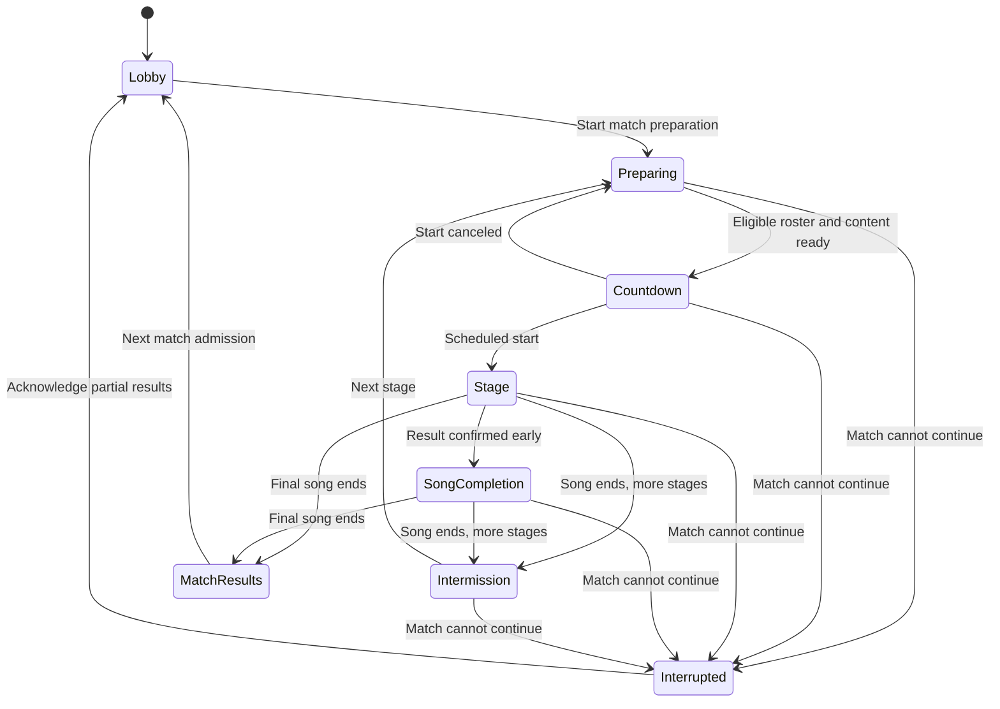

# Multiplayer navigation and screens

Status: first experience draft, 2026-11-09. Defines the menu tree, screen
families, states and layout priorities for the [battle design](multiplayer.md).
The room/match/stage hierarchy and admission choices come from that design;
screen names, arrangements and interactions below are proposals for review.
This document records planning and mockups, not implemented screens or approval
of adaptive balance. On 2026-11-10 the maintainer authorized a separate prototype
lane for CPU practice and invite-only rooms; its
[handoff](multiplayer-prototype-handoff.md) defines the implementation scope.
The remaining design work continues here. The reviewed examples are preserved
in the [repository mockup archive](../../tools/multiplayer-design/README.md).

Use the existing [UI core](ui-core.md), [Infinito theme](theme.md),
[play HUD](play-hud.md) and semantic controller navigation. Multiplayer is a
main-menu destination; Battle is its initial game mode. Hosted, automatic and
local describe how play is organized. Standard and Adaptive describe battle
presets, not additional navigation trees. Adaptive remains experimental until
its mechanics and eligible content are defined.

## Menu tree

```text
Main menu
└─ Multiplayer
   ├─ Find match                 Automatic public rooms
   │  └─ Match preferences → Finding a room → Room
   ├─ Browse rooms               Public hosted rooms
   │  └─ Room list and details → Room
   ├─ Create room
   │  └─ Room setup → Room
   ├─ Practice with CPUs         Local, no online service required
   │  └─ Practice setup → Local room
   └─ Join by link               Secondary action; pasted or opened invite
      └─ Room preview → Room

Online create/join/find action when signed out
└─ Continue with Twitch → Twitch authorization → Return to intended action
   └─ Recheck room/admission state → Join or show changed availability

Room / Local room
├─ Unified room                 Players/standings, selected song and playlist
│  ├─ Choose song               Host’s local library; song-select wheel
│  ├─ Rules pop-up              Preset summary; host editing between matches
│  └─ More / account / options  Contextual pop-ups; no room tab changes
└─ Stage preparation → Countdown → Play / Watch
   ├─ Elimination → Watch or inspect own result
   ├─ Confirmed victory → Winner finishes song
   └─ Song end → Stage results and intermission
      ├─ Next stage → Stage preparation
      └─ Final stage → Match results → Same room lobby
```

Opening an invite bypasses the home screen but still shows the room's rules,
capacity and entry timing before joining. It does not start a match or admit
someone into an ongoing song. The maintainer selected Twitch sign-in for initial
online identity on 2026-11-09, with other third-party providers possible later
and no game-managed password or registration system. A ranking ladder, chat,
friends list and server-region picker remain outside this screen draft.

## Sign-in and participant identity

Twitch is the initial identity provider. Retain a small internal player record
and game session to associate room membership, host permissions, results and
reconnects with the same person. This introduces no separate user-facing
registration, password or recovery flow. Map provider identity to a game player
ID; display names are presentation, never authority to reclaim a seat.

Proposed placement: Sign in in the multiplayer home header when signed out,
replaced by the signed-in name and an account menu. Public discovery and local
CPU practice remain available without sign-in. Require authentication before
creating or entering an online room, including waiting/spectating inside it.
Anonymous public spectating can be studied later. Private invite previews show
only what the eventual access policy permits before authentication.

### Screens and return flow

| State | Visible treatment | Next action |
| --- | --- | --- |
| Signed out | Sign in in the header; online actions retain their purpose | Authenticate when attempting online entry |
| Sign-in prompt | Compact panel naming Twitch and the destination | Continue with Twitch or Back; no game password fields |
| Authorizing | Waiting for Twitch; desktop explains the browser handoff | Open browser again or cancel |
| Completing sign-in | Progress while the game verifies the return | Resume the requested action after validation |
| Signed in | Display name, optional avatar and account menu | Enter room, personal options or sign out |
| Canceled or denied | Sign-in canceled; original destination retained | Retry, back or local practice |
| Failed or timed out | Sign-in could not complete; actionable reason where known | Fresh attempt, retaining invite/setup context |
| Sign-in required again | Session ended; identity needed to reconnect | Reauthenticate and restore existing eligibility |

Retain an invite destination or create-room draft across authorization. On
return, recheck the room, invitation, seats and match phase. Resume the intended
join when its terms still apply; otherwise show updated entry timing or the
failure. Authentication alone never means Ready, reserves an unassigned seat,
or admits someone into an ongoing song.

Web sign-in can navigate to Twitch and return to the game. Desktop opens the
system browser, keeps a waiting view, and provides a return-to-game path after
completion. The desktop handoff is still to be specified and must be bound to
the initiating attempt. A canceled/superseded attempt must not later switch
identity or join a stale room; pending destinations are controlled game routes,
not arbitrary callback navigation.

### Effects on lobby and intermission

Add a compact signed-in identity control to the room header, leaving role and
readiness in their existing places. All human room members, including waiters,
have authenticated identities. The host label describes room authority, not a
special Twitch account type. CPUs retain their explicit separate identity.
Use the provider's display name initially, with optional avatar; avatar loading
does not block readiness. Player details identify the provider and disambiguate
similar names without decorating every row with provider branding.

Changing a display name preserves player identity. Multiple clients using one
identity must not receive separate competitive seats in the same match;
replacement/reconnect behavior remains to be defined. External sign-in does
not establish that someone cannot own several provider accounts.

The account menu offers Sign out and, if useful, Change account. Switching
identity first leaves existing participation under ordinary forfeit/host-transfer
rules. Points stay with the original player. Reauthenticating the same identity
restores its record and eligibility, never resets elimination. Waiters retain
their waiting/admission state subject to actual room availability.

Renew tokens silently when possible. If authentication cannot be re-established,
show Sign in again and follow the server's disconnect/reconnect policy; never
automatically open a browser or interactive login dialog over active notes.
Confirmed revocation ends affected sessions rather than extending authenticated
play until song end. Preserve confirmed results; exact grace periods and
active-stage outcomes remain battle policy work.

### Provider integration boundary

Twitch supports OpenID Connect and a server-side authorization-code flow. Its
ID token supplies a user identifier (`sub`); display name and picture can be
requested, while email requires additional scope. Use issuer/provider plus
subject as the external identity key, mapped to a game player ID. Request only
sign-in/display information initially, without email, chat or channel-management
access. Validate the returned identity before creating a game session.
[Twitch OIDC documentation](https://dev.twitch.tv/docs/authentication/getting-tokens-oidc/).

An online authentication service should perform the confidential exchange;
neither the static web build nor the desktop executable can keep a client
secret. Twitch documents authorization-code exchange for a server that can
keep it. Desktop can share a backend-assisted browser flow; device-code
authorization is another documented option for limited-input clients. No
callback transport or authentication library is selected here.
[Twitch OAuth flows](https://dev.twitch.tv/docs/authentication/getting-tokens-oauth/).

Twitch requires apps maintaining its OAuth sessions to validate access tokens
at startup and hourly thereafter, ending affected sessions when authorization
is invalidated. Include validation, renewal and revocation in session design.
[Twitch token validation](https://dev.twitch.tv/docs/authentication/validate-tokens/).

Future providers use the same identity/session boundary. Do not merge identities
by matching names or emails. Linking providers to one player would require
explicit proof of control of both; it is future work, not an initial account
screen. Provider recovery stays with the provider. Local saves/practice remain
usable while signed out; signing in does not implicitly upload local history.

## Screen families

| Screen family | Main question it answers | Primary action | Supporting actions |
| --- | --- | --- | --- |
| Multiplayer home | How do I want to play? | Find match | Browse, create, practice, join by link |
| Sign-in | Which identity will I use online? | Continue with Twitch | Cancel/back, retry, resume intended destination |
| Discovery and room preview | What will I join, and when can I play? | Join room / Join and wait | Filter, inspect rules, cancel search, back |
| Setup | What kind of room or practice match am I starting? | Create room / Open practice | Choose preset, songs and CPU seats |
| Room | Who is here, what comes next, and what am I eligible for? | Ready or role-specific host action | Songs, rules, standings, personal options, leave |
| Stage preparation | Can this stage start, and what is blocking it? | Ready / Cancel ready | Resolve content, permitted play options, sit out |
| Play and watch | What is happening in this stage? | Play notes, or select a player to watch | Spectator standings; deliberate leave/forfeit action |
| Results | What happened, and what happens next? | Ready for next stage / Return to lobby | Personal performance, full standings, leave |

These are screen families, not a requirement for wholly separate
implementations. Setup reuses room settings; preparation reuses the prompt's
song/options presentation; results reuse the room frame and existing performance
details. Countdown/loading are states, not additional destinations in the menu.

## Multiplayer home and discovery

Home uses the start menu's short vertical list and established focus treatment.
The selected entry has a brief description alongside it. Show service status
near online choices; an unavailable service must not block local CPU practice
or the route back to singleplayer. Practice requires working CPU opponents;
ordinary perfect autoplay is not a substitute for the proposed opponent model.

Find match offers a small advertised set of supported presets, with the stage
count, content pool and CPU-fill policy visible before entering. Standard Battle
is the initial working choice; Adaptive Battle is a study variant, not a promise
of a working public queue. Do not create separate queues for every custom rule.
Matching seeks an automatic room admitting players for a new match; if only a
running match is offered, show the wait and let the player choose to join it.
Show searching, found, joining, failed and canceled as explicit states, with a
Cancel action throughout search. Never invent a precise wait estimate.

Browse uses a list and a selected-room detail pane. Each row contains room name,
preset, human/CPU participant counts, capacity, match phase and entry timing.
The pane adds current/next song, stage count, main rules and song-sharing/loading status. Distinguish room capacity from seats in the current match:
an eight-player match does not imply unlimited spectators or a total room cap of
eight. Spectator capacity policy is still open; show a full-room reason when it
actually prevents joining. Private rooms do not appear in discovery.

Use actions that reflect admission: Join room when the next match is preparing,
Join and wait when entry is next match only, or Join for stage 3 when custom
late entry can actually reserve an eligible place. Display "Earlier stages
earn no points" for late entry. A preview is not a seat guarantee; revalidate
on joining and show any change. A rejected/expired invite offers Retry or Back,
with no unrelated room selected silently.

### Concrete multiplayer entry study

Follow-up, 2026-11-09: the **Battle entry** conversation mockup contains six
starting views: Multiplayer, Public rooms, Find a match, Automatic room, CPU
practice, and Online unavailable. Each route continues into the existing unified
room composition. The three main choices are prominent; Create room and Join by
link remain secondary. Local practice stays usable when signed out or when online
services are unavailable. The home menu uses neutral plates and no initial
selected action; deliberate focus supplies the contextual description.

Public rooms use a selectable list and a song/rules/admission preview. The sample
distinguishes a preparing hosted room, a full eight-player match that still
admits watchers, a custom room accepting entry at stage 3, and a room with no
playing or watching places available. Human and CPU counts are separate. Searching
by room name and a small phase filter support browsing; empty/filtered lists
retain a route to local practice. The preview's primary action says Join room,
Join and wait, or Join for stage 3. Custom late entry explicitly earns no points
for earlier stages. It never inserts a player into the current song.

Browsing and inspecting the automatic preset do not require sign-in. The online
join/find action does. Sign-in preserves the selected room or Find match intent;
cancellation restores that selection. After identity returns, admission is
checked again: a room that started now offers waiting, while a room that filled
or closed shows that change instead of silently choosing a different room.
Joining never sets Ready. The invite action in this isolated study recognizes
only its explicit sample invite and opens a room preview independently of the
public directory; real invite validation remains covered by the earlier flow.

Find match advertises one Standard Battle rotation, four stages, up to eight
competitors, mines with accuracy weakening, and CPU fill. The illustrative
Opening set uses Single/Medium charts marked 5–7 and Gentle CPU profiles. These
are placeholder content/profile choices, not a published catalog, a calibrated
skill bracket, a rating requirement, or a new promise about mixed-skill balance.
The song wheel lets players inspect the rotation before searching. Automatic
rooms control those songs; players cannot replace them with their local choices.

Search remains cancelable and has no fabricated wait estimate. A delayed room-found
event after cancellation cannot join the player. When only a running match is
offered, joining to watch and wait is an explicit choice; Keep looking preserves
the search. Failure offers Retry and local practice. Once a new automatic room
is found, the study shows gathering followed by preparation. Gathering closure
and the readiness deadline are separate simulated server events; 15 seconds in
the preparation snapshot is the existing provisional test value, not a selected
gathering duration.

CPU-fill rows are marked At start until roster commitment. At the initial
readiness boundary, commit ready, loaded humans and fill the remaining places
to eight with named CPUs. With no ready human, wait instead of starting an
unattended CPU match. A human who misses that initial deadline watches and waits
for the next match, because they never entered this match's roster; this differs
from an admitted player missing a later stage. Loading intent is displayed as
Ready when loaded, not a completed Ready state. Failed sharing has a retry action.
There is no CPU replacement during the song and no participant-operated cancel
of the server's committed countdown.

Practice with CPUs goes directly to a local room rather than a separate account
or queue flow. The proposal starts with three CPU opponents and four songs from
an illustrative remembered local playlist. CPU count can be changed from one to
seven; Gentle, Regular and Challenging are proposed human-readable profiles that
include mine sensitivity, not implemented/calibrated bot specifications. The
player can choose one to four stages in this study, replace each song from the
local library using the same wheel, and choose its chart. Four stages is a default,
not a product limit of four. The study keeps its local setup when leaving and
returning. Local Start match needs no separate Ready action, authentication,
download, or online service; it leads through a cancelable countdown into a
representative stage-opening field with fresh life and power. The field is a
presentation sample, not a working CPU simulation. The chosen CPU setup and
opening chart are locked once the match starts. Variable-population point awards
remain a separate unresolved scoring question; no new award scale is selected here.

All online service, directory, OAuth and sharing responses are local study
controls. Checks cover navigation, sign-in cancellation, admission races, search
cancellation, waiting versus late entry, CPU roster commitment, loading deadlines,
offline practice configuration/start, cancellation, and saved-state restoration.
Browser rendering has not been visually inspected. Initial empty-library/import
onboarding, published automatic content pools, CPU profile calibration, queue
capacity, and controller focus in the real UI still need further review.

## Setup and configuration

Keep the initial setup short: room name and Public/Invite only for hosted play,
battle preset, songs per match, participant limit and CPU seats/fill. Local
practice omits visibility, links and network controls. Four stages and at most
eight competitors are the working defaults/cap; CPU skill and mine sensitivity
belong to practice/host CPU settings, not a player's self-rating prerequisite.

Use presets to supply coherent combinations; changing a supported competitive
rule marks the configuration Custom and shows the differences. Provide Reset
to preset. Put less common rules behind More rules, with plain descriptions.

| Configuration group | First visible controls | Additional controls and limits |
| --- | --- | --- |
| Battle | Standard / Adaptive when available, concise attack and defense summary | Mines-only defense comparison; Hidden/Sudden only after supported rules exist |
| Match | Songs per match, return after each song | Persistent-elimination ending policy; scoring summary/table |
| Entry | Public / Invite only; joining during a match Off | Close admission, replace invite; no late entry with the first persistent-elimination preset |
| Players | Participant limit, CPU count or fill | CPU profiles; explicit host transfer/member actions |
| Progression | Host starts / Automatic advance | Gathering, loading and intermission policy where supported |
| Personal | Targeting policy, scroll/readability, skin, audio | Existing personal options allowed by this preset |

Do not expose all simulation constants as public sliders. Numerical timing,
damage and weakening experiments can remain study inputs until meaningful
player-facing ranges and valid combinations exist. Experimental options may
appear in a design mockup marked as such; a released screen should not offer
an unusable rule. Autoplay and chart-altering personal modifiers cannot silently
remain enabled in a competitive seat; show the preset restriction before ready.

Competitive rules and match length lock at match start. The host may prepare
changes explicitly labeled "Next match"; they do not affect current standings
or reset current readiness. Choosing a different unstarted stage song clears
that stage's readiness and names the change. Personal targeting is selected
before the stage, not manipulated while hitting notes. (Reversed by the
maintainer on 2026-11-11: targeting can also be changed during play; see
"Decided (maintainer, 2026-11-11): attacks" under "Play and spectator
layout".)

### Room creation and rules study

Follow-up, 2026-11-10: the **Battle room settings** conversation mockup adds seven
views: Create room, Rules before starting, Invite-only room, CPU settings, Locked
for this match, Prepare the next match, and Between matches. It extends the same
room, song wheel and dismissible Rules/More language. These remain proposals and
local scripted interactions, not implemented room-management capabilities.

Creation asks for a name and Public or Invite only, with compact shortcuts to
the starting rules and CPU settings. Its working defaults are Standard Battle,
four stages, eight playing seats and CPUs Off for a hosted room. Creating the
room does not start a match, mark anyone Ready, or invent a chosen playlist.
Empty song slots lead to the host's local library. The existing shared-song flow
is expected to share committed choices automatically. The mock uses a separate
sharing-complete study control after choosing a song. Sign-in before creation
belongs to the entry-flow study and is assumed complete here.

The proposal distinguishes three scopes rather than mixing unrelated settings
in one Apply action:

| Setting | When it may change | Consequence |
| --- | --- | --- |
| Room name, Public/Invite only, new arrivals and invite replacement | Host can apply room-access changes during or between matches | Future discovery/admission changes; existing members, match rules and readiness stay unchanged |
| Attack/defense rules, return-each-stage rule, mid-match entry, match length and playing-seat limit | Before the match; locked throughout play and intermissions | Changes before start clear readiness and cancel an outstanding readiness window |
| CPU Off/Fixed/Fill policy, count, skill profile and mine sensitivity | Before the match; proposed to remain fixed for the entire match | No live opponent retuning, replacement or refill of eliminated seats |
| Next-match settings | Host, co-host or admin may prepare and save while a match runs | Explicit future proposal; does not touch current rules, standings, CPU behavior or readiness |
| Unstarted song/chart | Authorized operators may replace it under the existing song policy | Clear that upcoming stage's readiness and share the replacement; never alter the running or completed stage |
| Host/Automatic advancement | Authorized operators can change room operation | During play, takes effect after the stage; never pauses the song. Automatic advance requires prepared remaining content |

The room access pop-up uses a separate Save access action. Public means listed
in discovery; Invite only means hidden and joinable through its link. Closing
ordinary new admissions does not remove existing members or revoke the planned
admin/co-host access rules. Switching visibility does not implicitly rotate the
invite. Replace invite link has an explicit confirmation, and replacement is
committed only when access changes are saved. Cancel keeps the previous link.
The link shown is an example, not a generated live invitation. Non-owners can
inspect access but cannot edit it through co-host or implicit admin permissions.

Rules are edited in a draft with Apply/Cancel. Changing a supported battle rule
marks the battle Custom. Reset battle rules restores mines with accuracy
weakening, return each stage On, and mid-match entry Off; it preserves deliberate
match-length, capacity and CPU choices. The current study exposes play-through
as the defense alternative. It does not enable mixed Hidden/Sudden attacks or an
unsettled Adaptive preset through a generic custom-rule editor.

Persistent elimination and mid-match entry cannot both be applied. The editor
explains the conflict and requires a deliberate correction; it does not silently
flip another option. With persistent elimination, ranking follows survival
placement instead of the default per-stage-points system. The stage-count selector
offers one through eight in this study; that is a mockup range, not a decided
product limit or an eight-song restriction.

CPU seats can be Off, a fixed count, or Fill open seats. The preview separates
human seats from CPU seats under the combined limit. Fill yields to admitted
humans before roster commitment. A fixed count that exceeds available seats or a
limit below already assigned human seats blocks Apply; no player is silently
removed. Gentle, Regular and Challenging remain proposed human-readable profiles.
Low/Typical/High mine sensitivity describes how much mines disrupt the CPU,
separately from its general skill. These choices need calibration against the
future simulator and are not claimed to map to implemented MSD thresholds. The
study applies a common profile to the room's CPUs; per-CPU skill editing is not
introduced. Variable-population point awards remain unresolved.

During a match, Current match shows a locked summary. Prepare next match opens
an explicitly labeled draft with changed rows and before/after values. Save for
next match publishes that future proposal for participants to inspect; Use
current rules provides a way to undo planned changes. Co-hosts and admins can
prepare it without taking ownership or a playing seat. Ordinary participants
and waiting members see summaries without editing controls. The sample co-host
and admin are watching, so they have no personal Ready button.

At match completion, a valid saved proposal applies to the next match, clears
readiness and retains the previous match's rules/results as a separate record.
The room shows that settings changed. Stage-count reductions preserve the first
remaining playlist slots; increases add empty slots for explicit song selection.
Capacity is rechecked at the boundary: new human reservations may invalidate a
previously valid smaller limit. In that case the proposal stays pending, the
next start is blocked, and an operator must review it. The live roster and its
CPU count never change merely because next-match reservations changed.

If another operator starts the match while a rules editor has unsaved changes,
the study preserves those edits as a clearly labeled, still-unsaved next-match
draft. It never applies them to the newly locked match. This illustrates the
required outcome of an edit/start race; actual revisions and conflict handling
remain implementation design work.

Checks cover creation, Apply/Cancel/discard, preset reset, incompatible rules,
CPU capacity, explicit invite rotation, role permissions, readiness boundaries,
saved next-match proposals, late capacity conflicts, frozen CPU behavior, song
replacement and saved-state restoration. Browser rendering has not been visually
inspected. Real concurrent editors, seat reassignment, per-CPU profiles and
moderation beyond the established role model still need separate work.

## Unified room layout and roles

Revision, 2026-11-09: the maintainer prefers spatial hierarchy and familiar
controls over explanatory copy. Combine Lobby, Songs and Standings into one
room view. Rules opens a dismissible pop-up using the same interaction language
as More/Add songs. This supersedes the earlier tabbed room and separate host
control band; role permissions and admission rules are unchanged.

Preserve the established song-select composition: selected song art, title,
metadata and chart ladder to the left of a song wheel. Extend it with a compact
participant/standing column at the far left and the match's ordered songs in
the wheel. Stage numbers, completed marks, selected-row size/outline, chart
meters and position carry meaning before text does.

```text
After Hours  [private]          Stage 3 / 4    Rules   [name]   More
┌──────────────────┬───────────────────────┬─────────────────────────┐
│ Players / rank   │ Selected song art     │ Match song wheel        │
│ Name · pts · ✓   │ Title / artist        │ 1  Previous song ✓      │
│                  │ BPM · time · layout   │ 2  Previous song ✓      │
│                  │ Chart ladder          │ 3  NEXT SONG            │
│ Next match       │                       │ 4  Choose song          │
│ Waiting players  │ Change song [host]    │                         │
│                  │ Stage result          │                         │
└──────────────────┴───────────────────────┴─────────────────────────┘
Status / blocker                     My options   Ready  |  Start [host]
```

Use Infinito's dark ground, quiet plates, Iosevka-style typography, art-tinted
backgrounds and vivid active outline. The HTML study approximates the selection
geometry; it does not implement the game's full wheel physics or claim final
pixel fidelity. Its fictitious songs and people are sample content. The live
implementation should reuse the shared selection components and input behavior,
not introduce an unrelated card gallery or a new list convention.

Built, 2026-11-12 (the maintainer's feedback on the prototype: the
players visible without pressing Players): the participant column is the
**players panel under the song**, not a column at the far left. In a
room the song's side is short (a small banner with the title and a line,
one row of chart buttons, the style button only where the room plays
more than one style) and the panel takes the rest of its column: place,
name with role or stars, state in words, match points, a line a player,
nine without scrolling at 1280×720; the same for the host and the
followers. A phone shows them as one line over the list that opens the
full list. The wheel stays the host's library (M7b), not the match's
songs; the match's picks are in the followers' list's place and in the
Players pop-up. What is built and why the far-left column was not
chosen: `docs/plans/multiplayer-prototype-progress.md`, "Feedback round
B".

Decided (maintainer, 2026-11-12): a room opens straight on its song
select with the default rules; the Rules pop-up no longer opens by
itself on entering (a hidden option, off by default, keeps that:
`mprules=1`, `--mp-rules-first on`). Rules stays behind its button.

### Role differences

Host/co-host/admin control is separate from the participant/waiting role below.
The [room-control proposal](multiplayer.md#room-control-co-hosts-and-server-administrators)
adds optional named co-hosts and implicit server-admin co-host access. Authorized
helpers see song/progression controls even while watching; their personal footer
still says Watch rather than Ready until admitted to play.

| Area | Participating host | Participant | Waiting for next match |
| --- | --- | --- | --- |
| Identity | Signed-in name; room host marker | Signed-in name | Signed-in name |
| People column | Roster with readiness; ranks/points during intermission | Same, own row marked | Same; own row in the separate Next match group |
| Song selection | Inspect any stage; change only unstarted stages through local-library picker | Inspect playlist/chart; cannot change the room selection | Same preview without competitive admission |
| Footer | Own Ready, then a separated Start action | Ready / Cancel ready | Watch; no disabled Ready control |
| Other controls | Rules, More, Invite and player management | Rules and personal options | Rules and personal options |

Host authority remains separate from participation. A host who is not playing
gets their watch/wait footer plus Start; they do not ready a noncompetitive seat.
A playing host must ready themselves before starting. Ready counts exclude
waiting people. Icons distinguish ready, pending load and not-ready states;
accessible names and inspectable details spell out those meanings. Preserve
short blocker text when it matters, particularly missing content or a failed
transfer; minimal copy must not make a disabled Start mysterious.

In larger rooms keep a bounded roster/standing column with the local row
available and a full participant pop-up. Never widen the room to accommodate
100 names. At compact widths keep the song-detail/wheel relationship while
space permits, then stack; move participant detail below the musical content.
Role actions remain reachable through the game's semantic controller controls.

Rules is a modal pop-up with current values and a close/back action, preserving
selected stage, focus, membership and readiness. Changes during a match are
labeled Next match. More holds invite, player administration and Leave room;
the identity control holds provider/account actions. Pop-ups use one input
layer and restore their opener's focus. They are not additional room pages.

### Choosing and automatically sharing songs

The maintainer's requirement is the host's **entire local library**, not a pool
restricted to songs everyone already has. Open the familiar song selector from
Change song or an empty playlist stage: song art/chart ladder on the left,
search and pack/song wheel on the right. Songs remain visible even if they lack
a chart compatible with the room; show that specific restriction and prevent
committing an incompatible chart. Adaptive chart eligibility remains separate.

Browsing candidates changes only the host's preview. Commit a song and chart
with Use for stage N; then update the room's playlist and automatically share
that selected content with participants. Do not publish the whole local library
or reset readiness on each wheel movement. Changing the upcoming stage clears
its readiness; preparing a later stage does not clear or block the current one.
Past competitive stages are immutable.

The existing [shared-song service](shared-songs.md) already uploads song content
and supports shared-song playback on web and desktop. Reuse that mechanism for
room-managed distribution and caching. Its currently documented upload
credentials are bearer tokens; connecting Twitch sessions to room upload
permissions and automatically coordinating room content are integration work,
not new capabilities already implemented. Existing shares do not by themselves
provide private-room access semantics; room distribution/expiry policy needs
an explicit decision. Do not promise room-exclusive file access just because
the room is invite-only.

No Share dialog or link copying belongs in the ordinary room flow. Show an
upload/download indicator by the affected song and loading state by the affected
player; show bytes only while useful. Start gates on the upcoming stage's
required content and readiness. Prefetch later songs independently. Retrying,
expired content and actual transfer limits need visible recovery without
artificially restricting the library to preinstalled songs. Shared playback
uses the existing temporary/shared origin rather than silently adding songs to
every participant's permanent library. Local CPU practice needs no upload.

### Invite and sign-in study

The revised study begins with a signed-out invite naming the room and host.
Continue with Twitch leads to a clearly marked simulated provider step, then
a signed-in return to the same room. A study toggle makes the match start during
sign-in: on return, the person appears in Next match with Watch; if admission
is still open, they get an admitted row and Ready, never automatic readiness.
A canceled attempt returns to the same invite. The desktop variant labels the
browser handoff and return-to-game action. These transitions are local mock
interactions, not actual OAuth or real room admission.

The same study includes host lobby, host/player intermissions and waiting views.
It now also includes full stage evaluation and an interactive hosted readiness
deadline, including ready-in-time and sitting-out outcomes.
Its Rules and account/More controls open pop-ups, and the host can browse songs,
choose a chart, commit it and see a simulated transfer. Study controls expose
transfer failure/completion and other-player readiness. Transfer progress in
these examples is scripted, not a backend measurement.

## State model

Room phase, local participation, readiness and connection are separate facts.
Authentication is another independent state: being signed in does not imply
room admission, and a transport reconnect does not prove identity by itself.
For example, an active stage can coexist with a newcomer waiting for next match,
an eliminated participant watching, and a host still playing. Viewing Standings
does not change any of those facts.



SongCompletion is the remainder of the current song after a confirmed result;
it never means permission to skip the winner's remaining notes. The final-song
transition also covers an earlier completed match under the custom persistent
elimination ending rule. Stage interruption and its handling follow the battle
rules; until a continuation policy exists, show incomplete results rather than
silently awarding points or replaying a scored attempt.

| Local participation | Visible status and action | Next competitive opportunity |
| --- | --- | --- |
| Admitted, not ready | Ready, options, or sit out | Upcoming stage once ready and loaded |
| Ready requested, loading | Loading required content; Cancel ready | Upcoming stage if loading completes in time |
| Ready and loaded | Ready; waiting for host/other players/deadline | Committed countdown |
| Competing | Local field and battle HUD | Current stage |
| Eliminated this stage | Placement if confirmed; Watch / My result | Next stage by default |
| Eliminated for match | Watch / Standings; return next match | Next match |
| Confirmed winner finishing | Stage won; continue playing | Next stage/match after song ends |
| New arrival waiting | Watching; waiting for next match | Next match by default |
| Late entrant accepted | Joining stage N; earlier stages worth zero | Next stage, never the ongoing song |
| Sitting out / missed readiness | Not playing stage N; zero stage points | Later stage if eligible, otherwise next match |

Ready is a declaration of intent and can be selected while loading. Eligibility
requires both that intent and completed required loading. Do not display Ready
for a player still unable to start. A dedicated start button remains separate
from ordinary confirm/navigation. Automatic advancement follows the disclosed
timer and readiness policy; entering a room or browsing results alone is not a
ready action. Exact timer durations and optional auto-ready behavior remain open.

Connection states are Joining, Connected, Reconnecting and Disconnected. Show
them without inventing a pause in the battle. Reconnect restores the existing
identity and authoritative eligibility; it does not clear attacks, respawn an
eliminated player or create a new scoring row. Show a grace countdown only once
the rules define an actual deadline. Resume mid-song only if the eventual
reconnect rules permit it; otherwise provide Watch and the next eligible entry.
Failed authority produces Interrupted, never a local victory announcement.

### Connection-loss and return study

Follow-up, 2026-11-09: the **Battle reconnecting** conversation mockup adds eight
views: Connection lost, Back in the stage, Out this stage, Watching after return,
Back in the room, Missed the next start, Sign in again, and Room unavailable.
These are scripted UI states, not a networking prototype. In particular, the
study's Resume confirmed event represents an authoritative eligibility decision;
a restored socket or successful Twitch login alone cannot produce that decision.

The proposed experience keeps a brief connection interruption separate from
losing participation in a stage:

| Situation | What the player sees | Participation and next action |
| --- | --- | --- |
| Connection interrupted while the existing play continues | Normal local notes and known attack mines; a quiet Reconnecting status below the field, with Result pending. Remote previews become visibly stale rather than continuing invented judgments. | Keep playing locally while recovery is attempted. No confirmed result, new attack launch effect or winner announcement is inferred. |
| Transport returns, stage state still being checked | Checking stage; the existing play continues where continuity is still possible. | Identity, current phase, eligibility and event history still need validation. There is no manual Resume button that overrides the room. |
| Same running play is accepted | Brief Connection restored status; same field, life, power and known mines. | Continue at the running song time. No restart, respawn, resource reset, repeated start cue or removal of committed hazards. |
| The room confirms that connection loss ended participation | Out this stage, Connection lost, zero stage points, earlier total, and the next eligible stage. The local field stops; its old life is not animated as damage. | Watch or Room. This is a proposed disconnect-forfeit outcome, distinct from ordinary life-based elimination. |
| Already eliminated when connection returns | The existing placement and award remain; watching is available. | Reconnect cannot revive the player. In the study, fifth place remains +4. |
| Reopened game or interrupted authenticated play | Restore room membership and check the authoritative result; the study does not resume a newly loaded chart midway. | Watch the current stage or wait for the next eligible stage. A prior confirmed win remains saved. |
| Return in intermission | Same participant row, prior points and song wheel; Ready initially off. | Explicitly ready for stage 3. A returning participant is not subject to the newcomer rule that would make Nia wait for the next match. |
| Return after the following stage started | Stage 3 playing; local Not played · 0 and Next · Stage 4. | Watch now, return at stage 4. Never join an already running song or rewind the room. |
| Persistent elimination enabled | Next match replaces next-stage eligibility. | Reconnection cannot reset the custom room's elimination rule. The study treats a disconnect forfeit as ending participation for that match under this rule. |

The active-loss view also has a remote-peer alternative: only Sol's miniature
becomes stale, while Kai's local play remains normal. Stale life and power are
last-received values, not a protection effect or an authoritative claim that the
player is still alive. Previously eliminated miniatures remain Out. A disconnect
does not replace a human with a CPU or free their identity for another player to
inherit. Host status and any accepted ownership transfer remain independent of
this player-slot recovery; the earlier room-control study covers that flow.

The example gives Kai 7 points from stage 1. A confirmed stage-2 disconnect
forfeit adds zero; ordinary fifth-place elimination would add 4; a previously
confirmed win adds 12 and remains saved across connection loss. While the result
is unknown, display a dash/Unconfirmed, never a manufactured zero. Local play
during an unresolved gap is provisional; it is not automatically a valid scored
continuation. Unplayed notes after participation ends are not added as misses.

No grace countdown is shown: its duration, starting checkpoint and authority
have not been chosen. A recoverable interruption must eventually be defined in
terms of sufficient event history and safe timing, not just elapsed network
downtime. The implementation design must account for known and newly committed
attacks, missing acknowledgments, clock continuity and input verification. It
must not retroactively insert hazards inside their promised notice window,
release a burst of deferred attacks, grant immunity while offline, or accept an
incomplete history as a successful resume. If that continuity cannot be supported
fairly, the conservative first version should restore watching/room access and
next-stage eligibility without allowing competitive mid-stage recovery. This
study exposes both outcomes without selecting a transport or promising a grace
window. Confirmed forfeit timing and the zero-point policy still need agreement.

#### Identity, unavailable rooms and saved outcomes

If sign-in is required again, preserve After Hours as the return destination and
Kai as the required identity. Show a deliberate Sign in with Twitch action away
from active note play; never launch a browser or OAuth modal automatically over
the field. Cancellation stays recoverable. A different account cannot take Kai's
row or points. Successful sign-in returns to Checking participation, then the
room's current phase and eligibility. It neither readies the player nor restores
an authenticated play session that already ended. Network Retry cannot bypass
the outstanding identity requirement.

An unreachable room says Could not reach the room and leaves the stage outcome
unconfirmed, with Retry and a route back to Multiplayer. Only a confirmed room
closure or authority interruption gets Room closed or Match interrupted. A
closed room may retain previously confirmed individual results without claiming
the entire match finished. An interrupted unresolved stage has no award; earlier
completed stages remain in partial results, without an overall winner. A stage
win sealed before a later match interruption remains a completed result and is
not revoked. Reconnecting never replays its victory announcement.

The study controls simulate server and Twitch responses; no service, actual
login or reconnect attempt is made. Checks cover the eight states, same-session
return, preserved hazards/resources, no respawn, manual readiness, missed starts,
identity gating, saved wins, unavailable versus interrupted outcomes, and bounded
state restoration. Browser rendering has not been visually inspected. Exact
deadlines, server validation, duplicate clients, deadline races, and reconnecting
after a new match replaces the old one still need further mechanism work.

## Stage preparation and countdown

Reuse the start prompt's stable song card, chart information and personal option
access. Add stage number, battle summary, own participation and a compact ready
count. List blockers inline: missing song, incompatible chart, required loading
or a player not ready. Provide the relevant recovery action where available,
without promising automatic content downloads.

When committed, replace readiness actions with a clearly visible shared
countdown and the admitted roster. This is not singleplayer's skippable start
timer: a local Start press cannot advance everyone else's clock. If the start
is canceled, restore preparation and show why, retaining existing match points.
Optional announcer assets never block starting. Countdown invalidation cancels
its queued voice cues too.

## Play and spectator layout

Preserve the player's field size, position, receptors and judgment readability.
Build battle information around the existing HUD rather than shrinking the field
to make eight opponent fields fit. Reserve space for lyrics, Reverse, touch
controls and other existing overlays during later visual review.

The maintainer's follow-up preference is to keep the normal gameplay look and
represent opponents with miniature views close to their own gameplay. This
supersedes the initial roster-led sketch. Preserve the full-size local field and
normal life, judgment and combo placement, with score optional; distribute small
opponent fields through the side space. Keep population information quiet, without
adding the room screen's header, panels or navigation chrome to active play.

Put the incoming warning and power indicator close to the field edge, readable
without scanning a distant screen corner. Keep life as the danger signal; power
has a distinct visual treatment and label. A full bar can say Waiting for target
when no launch is eligible, with no flashing instruction to press Attack.
Show the actual recipient only after commitment. Retaliate/Spread/Leader is a
quiet policy label; there is no target-selection task during play.

For eight participants, show all seven opponents as small fields with an
external name/CPU label and life. Use stable slots, including a quiet Out state,
instead of moving the surviving fields after every elimination. During play
these are passive views, not target-selection controls. For 100+, retain the
local field and use a separate miniature-density/selection policy; the study's
twelve-preview sample is a layout experiment, not the final display cap. Detailed
standings and player browsing stay outside active note play. Never imply a live
provisional ordering is already a confirmed placement.

Incoming cues remain visible without audio. Show weakening as part of that same
attack warning. Do not add a permanent recent-accuracy defense meter. Adaptive
would add current challenge and an upcoming switch cue, not another equally
prominent progress bar. Its protected opening must be visibly different from
the competitive stage; label the switch into battle. It uses the same play
layout with the applicable preset information.

On elimination, stop local competitive input and show a brief outcome with the
next eligible stage. Default to watching after the outcome, while retaining My
result and Standings. Finishing a lost song noncompetitively is still a separate
unselected proposal, not assumed here. A spectator follows one selected field,
clearly labeled Watching [player], with other miniature fields beside it and visible
controls to change the followed player. If that player is eliminated, choose a
remaining player and visibly update the label. Detailed remote chart playback
depends on a spectator transport; a battle overview must remain usable when
that stream is unavailable.

A confirmed winner keeps the field and song; show Stage won without a blocking
results panel, stop incoming/power activity and suppress battle-danger cues.
Spectators see Winner finishing song, not Next stage starting. Personal chart
statistics may continue, while competitive placement and points stay frozen.
An apparent sole survivor awaiting outstanding attacks gets no premature win UI.

Decided (maintainer, 2026-11-11): the power bar goes directly above the
life bar, on the local field and on every opponent miniature. The
prototype's miniatures (`docs/plans/multiplayer-prototype-progress.md`,
M6b) place their life gauge on their field exactly as the play's HUD
places the local one (scaled to their lanes), leaving the same room above
it for the power bar. During a stage the dancing hand goes behind the
field and never claims a side of the screen: the miniatures use both
sides.

Decided (maintainer, 2026-11-12): no list of opponents. Every opponent of
a room's stage (eight at most) keeps its own miniature at every size, as
large as the sides allow, with lyrics shown too; a phone held upright
seats them in the margins beside the field. What is built:
`docs/plans/multiplayer-prototype-progress.md`, "Feedback round A".

Decided (maintainer, 2026-11-12): CPU levels. Ten levels, the five there
were as the upper five and five weaker ones under them, and a level is
shown as five stars wherever it shows (levels 1 to 5 silver from the left
over empty outlines, 6 to 10 gold from the left over silver), never as a
number or "of 5". This overrides the earlier lines of this document that
write a CPU's level as text.

Decided (maintainer, 2026-11-11): attacks. These decisions answer the
attack plan's open questions and override the earlier lines of this
document where they differ
(`docs/plans/multiplayer-prototype-progress.md`, M8a, for what is built):

- D0, the ruleset is a match rule: everyone in the room plays the
  match's ruleset (a Rules row; the match's rules carry its id), the
  stage's play, the CPUs and the bots alike, never a player's own
  Options ruleset. New rooms play ITG FA+.
- D1, damage: a battle shock costs exactly the match ruleset's miss to
  the gauge; score and accuracy are untouched; FFR's shocks are judged
  in 70 ms.
- D2, power by timing class: about the Fantastic window earns 2, about
  the Excellent window 1, anything worse 0 (ITG Fantastic/Excellent;
  ITG FA+ blue and white Fantastic/Excellent; SM5 Flawless/Perfect; DDR
  A, X and Extreme Marvelous/Perfect; FFR Amazing/Perfect). A full bar
  is 100 and an attack costs 100. Recent accuracy follows the same
  classes.
- D3, combo: a shock breaks the combo exactly where the match ruleset's
  own mines do (DDR A, DDR X), nowhere else.
- D4, no weakening: every attack is eight shocks. Recent accuracy no
  longer removes any (the "Show weakening" lines above no longer apply);
  a recent-accuracy figure stays only if Leader's tie-break needs it.
- D5, lead per target: an attack's section starts at or after its
  checkpoint plus the target's own lead (its reading horizon, a 1.5 s
  warning and about 100 ms so the warning shows on time; at least four
  beats, at most 10 s, slower settings raised on stages and said on the
  prompt). Online play must start every player's stage together as
  closely as reasonably possible; then the ~100 ms covers the warning
  and everything runs on the target's time.
- D6, settlement: no Stage won while an attack against the sole survivor
  is outstanding; a knockout by it shares first with those out just
  before; the results say "Drawn: final attack".
- D7, the dancing hand does not dodge shocks in this version (it may
  step through them; judging is unaffected); later through its streaming
  input.
- D8, rules: attacks are On by default in practice; online Off and
  locked ("Online attacks come later"). Targeting Spread (default),
  Retaliate or Leader (most life, ties by score, then seeded), chosen
  before the stage (the prompt, the player rows) and changeable during
  play: a small quiet label by the power bar shows the current policy,
  and a tap or click on it, Tab or the controller's View/Select cycles
  Spread, Retaliate, Leader (a control bound to a lane in the chart's
  layout is skipped); the change applies from the next checkpoint and is
  recorded in the play so replays and the authority agree. This reverses
  "selected before the stage, not manipulated while hitting notes" and
  "Retaliate/Spread/Leader is a quiet policy label; there is no
  target-selection task during play" in its permanent-label sense, and
  removes "targeting-policy text" from what "Less text and the dancing
  hand" removes. CPU shock sensitivity is by level only (no Rules row,
  no roster override), modeled as one avoidance value per CPU so that it
  can become a skill axis later.

Decided (maintainer, 2026-11-12): DDI in rooms, and attacks as a rule.
These override D0, D1, D3 and D8's first sentence above
(`docs/plans/ddi-ruleset.md`, "What it means for multiplayer (M8)" and
"Round 3 (built)"; `docs/plans/multiplayer-prototype-progress.md`, "The
DDI ruleset's round 3", for what is built):

- D0: rooms play DDI alone; the Ruleset row is gone; DDI's Difficulty
  (Normal by default) and Boos (Off by default) are match rules;
  Practice is never offered.
- D1 and D3: a shock is a mine: −5 life on Normal (−1 Easy, −10 Hard),
  the combo broken and its lane locked for a second.
- D2: DDI's W0 and W1 earn 2, W2 earns 1.
- Attacks are a match rule, Off by default and fully accessible, not a
  development switch ("multiplayer itself is already behind a
  development flag"): the Rules pop-up's Attacks row. Offered in CPU
  practice; an online room shows it unavailable until online attacks
  are built.

Decided (maintainer, 2026-11-12, after testing attacks: "I think it's
working really well, we can switch it to On by default"): the Attacks
rule is On by default wherever attacks are offered (CPU practice today),
still a rule anyone turns Off in Rules. This is D8's first sentence
again. An online room keeps playing without them, and says so in its
Rules row, until online attacks are built.

Built (2026-11-12, M8 round 3; `docs/plans/multiplayer-prototype-progress.md`,
"M8 round 3"): D8's targeting as decided, with these choices where the
decision left room.

- The policy is each member's own in the room's model (`Member::targeting`,
  Spread until chosen), shown quietly on every player's line of the players
  panel and of the Players pop-up while the match has attacks, and chosen
  on the stage's prompt: one row, "Targeting ◀ Spread ▶", with a line
  saying what the policy does. Changing it clears nobody's readiness,
  one's own included (the plan said it would): it is nobody else's rule,
  and it can change in play anyway.
- In play the label is one small muted word under the life gauge's left
  end (the waiting line keeps the right end and no longer repeats the
  policy). Tab, a tap or a click on the label (or on the left of the two
  bars above it) cycle it. On a controller View/Select is the button that
  quits a play (held, or pressed twice), so in a stage with attacks a
  short press of it cycles the policy on its release, holding it still
  quits, and pressing it twice no longer quits there (two quick presses
  are two steps of the cycle, never a forfeit). A key the player's
  bindings give to a lane stays the lane's.
- The change is in the play's log at its judged second and reaches the
  ledger with the next checkpoint's report; the room's member keeps what
  the play left the policy at for the next stage.

### Concrete play HUD study

Follow-up, 2026-11-09. The play/watch study contains Automatic attack, Incoming
lightning, Charged/waiting, Playing, Hand behind field, Score visible, Eliminated,
Watching, Winner finishes and Large party views.
The revised study uses the
repository's Infinito note contours, mine artwork and Iosevka fonts, with static
approximations of their materials. Notes, judgments and player data remain
illustrative; this is not a capture of the game or a working spectator stream.
Production should reuse the actual gameplay renderer, noteskin and HUD.
The study preserves the life gauge's centered, nonlinear fill and keeps its
true life value distinct from the attack-power percentage.

| Element | Placement and behavior |
| --- | --- |
| Incoming | A small shock-arrow mark beside the receptors with one dot per committed mine. No permanent sender name, large number, countdown or weakening paragraph. Its accessible description and optional tooltip retain exact count and weakening. The reserved/active attack rule means there is no stacked attack queue. |
| Power | A thin bar immediately above life in both the main field and every opponent miniature. It fills from one end, unlike centered life, and uses a different color and thickness. Full gains restrained electrical detail until an admitted launch spends it; reduced motion keeps a steady glow. No attack button or persistent numeric percentage. |
| Other players | Seven small gameplay fields in stable side slots, with name/CPU labels, power, life, notes, holds, received mines and judgment/combo feedback. Elimination leaves an Out slot. These are views of other players, not provisional placement ranks. |
| Large party | Remaining/total count and a denser sample of miniatures. The current twelve-preview example leaves the local field unchanged; final density, relevant-player pinning and access to other opponents remain design choices. Full player browsing belongs to spectator/menu interaction, not active note play. |

The incoming count is fixed at commitment: for example, eight mines reduced to
six shows six dots. It does not suggest that improving accuracy now will remove
more of this already-committed pattern. This quieter revision removes the earlier
four-beat numeric lead display. It does not change scheduling: admission and the
visual warning must still precede the earliest possible visibility, with enough
reading time under permitted settings. The cue persists through the warning
interval and is quieter once mines are in the field. Its recognizability without
an announcer needs play testing; subtle must not mean invisible.

After the affected section clears, the mark becomes a small recovery shield.
Do not display a guessed
four-beat expiration: recovery also requires subsequent original judgment
opportunities. There is no extra accuracy-defense bar, overlapping attack toast,
screen shake or required manual attack/target input.

Reverse moves the warning toward the lower receptors; power stays above life.
In the narrow study, the cue fits beside the gauge/optional score area and the
miniatures follow the main field. The life gauge and receptor positions do not
move when score is toggled. Actual supported play sizes, lyrics, touch controls
and backgrounds still need review in the game renderer.

### Less text and the dancing hand

The latest proposal hides accuracy/score in active battle and opponent previews
by default. Keep those metrics in evaluation; hiding a metric does not alter its
calculation or any accuracy tie-break. Score visible is a comparison, not a
decision to remove the user's display choice. Judgments, combo, life, power and
a small remaining/total counter provide the default in-play information. Remove
the always-visible song/stage header, targeting-policy text, last-recipient name
and power percentage. Keep player/CPU identity, spectator identity, elimination
and victory context where they explain who is playing and what happens next.

Explore the dancing hand behind the note band. Proposed paint order: background,
hand, the field's translucent contrast layer, then notes/mines/receptors and HUD.
Dim the hand rather than the notes; the gauge and attack cue remain foreground
elements. The comparison uses a static rendering of the existing hand mesh in
its stored pose, not the moving game renderer. It tests placement only. Motion,
bright skins, dense charts, mine visibility, Reverse and reduced motion need a
real gameplay check before adopting this as the default. Keep the hand toggle;
changing this layer must not change hand planning, note timing or judging.

### Target connection and electrical attack feedback

The maintainer proposed connecting charged power to the recipient's miniature
with a curved line, using the existing shock-arrow appearance as the visual
theme. The Infinito noteskin already distinguishes the shared spiked mine from
lane-shaped shock arrows (`ShockArrows`); both represent the same judged hazard.
Using a shock-arrow symbol in battle UI does not introduce another attack type
or force every player's selected noteskin to change its mine appearance.

Proposed sequence:

1. Full power gains a small electrical edge. It still waits for an eligible
   checkpoint/opponent; full alone neither spends power nor reserves a target.
2. At commitment, spend power and reveal a thin curve from the source bar to the
   recipient's bar/miniature. This depicts the admitted recipient, not an
   unconfirmed candidate that might be replaced or become unavailable.
3. A brief lightning pulse, using the shock-arrow motif, travels along the
   curve. The recipient's miniature receives one restrained highlight, then
   the connection fades. Highlight the frame rather than washing out its notes.
4. For an incoming attack, reverse the connection from the sender's miniature
   toward the local bar and emphasize the local field's edge. The small incoming
   warning appears at commitment and remains after the electrical effect ends.

The pulse acknowledges scheduled hazards, not instantaneous damage. It does not
move life, award a hit/kill or postpone the real warning until its travel ends.
Mine visibility, weakening and judging still follow the committed chart section.
The recipient's actual mine contacts are separate events. The demonstration's
charge/flight/highlight durations are presentation samples, not new checkpoint,
network or chart-delivery timings.

Keep connections in the side space outside the local reading area. Show the
local player's incoming/outgoing relationships, or the selected player's while
watching, rather than all room-wide attacks at once. The early eight-player
layout has all recipients visible. A larger layout will need an explicit target
preview or edge indicator when the recipient is outside its displayed subset;
the twelve-preview sample does not settle that policy.

Avoid repeated brightness flashes while charged. Reduced motion uses a steady
charged bar, static curve and recipient outline, without a traveling bolt or
pulsing frame. Existing announcer Incoming/Launched semantics remain: at most
one relevant event per commitment, no new line for every arc or flash, and no
instruction to press Attack. Spectators retain neutral perspective.

Automatic attack and Incoming lightning show a still mid-flight snapshot until
the study control Play automatic attack sequence is enabled. That control plays
one local sequence; toggling it off/on replays it. Charged/waiting demonstrates
full power without a target line. These are mock presentation states, not a
manual attack control in the game or a battle simulation. Motion and reduced
motion are implemented in the study, but rendered animation/readability have
not yet been visually validated in the game.

Built (2026-11-12, M8 round 3; `docs/plans/multiplayer-prototype-progress.md`,
"Who attacks whom"): the connection as proposed, for the local player's
own attacks, with these differences. The line is drawn in straight legs
through the side space's gaps (along the top at the power bar's height,
down beside the miniature's column), not as one free curve, so that it
is never over the field, the HUD, the judgment, the quit button or
another miniature at any size. The pulse is a bright dot along it
(0.6 s), not a shock-arrow motif. The miniature is outlined for as long
as the attack is on its way and passing, not for one highlight. An
incoming line from a miniature on the left ends at the field's left edge
on the receptors' row (the warning stands at the right edge). Beyond the
cap the attacker and the latest target stay in view while their attacks
last and one turn after. Looked at in headless Chrome and Firefox; not
yet judged by a person in play.

### Faithful miniature fields

Treat an opponent miniature as a small rendering of that player's gameplay,
not a decorative animation driven by their life percentage. Render the same
effective chart, current chart position, holds, committed injected mines and
judgment results. Preserve their allowed display settings, especially Reverse,
scroll speed, lane transforms and active visibility effects. Match their
noteskin and color choices when those assets are available. The study demonstrates
this through different scroll speeds, Reverse, mine patterns and feedback; the
main watched field and its miniature use the same sample presentation data.

Proposed transport: reconstruct previews locally from identified shared chart
content, the player's settings and timestamped gameplay/battle events. Explore a
small playback buffer for coherent remote judgments and input effects. Smooth
note motion between updates, but do not infer hits, misses or combo changes from
the fact that a note crossed a receptor. A delayed preview is not the authority
for elimination, attack admission or victory. Those still use confirmed battle
events. The buffer, drift correction and update budgets remain design work.

Prioritize the field and gameplay HUD at miniature scale. Song videos, lyrics,
background scripts and the dancing hand can remain outside the miniature's
initial fidelity target; this does not disable them in the local player's normal
gameplay. Reserve their actual local bounds when placing the preview banks.
Noteskin discovery/sharing and safe rendering need their own policy: the existing
song-sharing mechanism alone does not guarantee another player's custom skin.
Any temporary skin fallback must be disclosed rather than presented as an exact
copy of that player's view.

Missing preview data gets a visible No feed state; independently received life
and elimination information can remain. Degrade miniature update/detail budgets
before changing local input, judgment or rendering cadence. The full eight-player
case should exercise seven concurrent views; the eventual 100+ layout needs
separate performance and readability tests before choosing a dense wall, pages
or a bounded selection of previews. This study chooses no final transport,
renderer budget or spectator latency guarantee.

### Elimination and ownership of the viewed field

On confirmed elimination, stop local competitive input and freeze the personal
result. Briefly dim the local field and show placement, points where defined,
and Back for stage N (or Next match under persistent elimination). Then follow
a remaining player by default; Watch skips the outcome interval. The mock holds
the outcome until Watch is selected so the transition can be inspected. Clear
held gameplay inputs before enabling spectator navigation, so the final note
press cannot accidentally switch players or open a menu.

The field's identity strip becomes **Watching [name]**. Incoming and power belong
to that named competitor; the viewer's own frozen placement and My result stay
in a separate footer. Selecting a live miniature, the Players list or
Previous/Next promotes that player's view into the main field, preserving their
display settings and changing none of the viewer's results. Keep the selected player
until they leave the live set, rather than chasing whoever currently leads.
Auto-follow can then choose another survivor with a visible identity update;
with it off, show that the followed player was eliminated and offer selection.
Neither choice respawns the viewer or changes their next admission boundary.

A room observer, including an assisting admin, has the same viewing controls
but no invented personal defeat, score or My result. They remain outside the
competitive population. If remote field data is unavailable, replace the field
with Field unavailable while retaining independently available battle status and
player selection. Never pass a frozen remote judgment display off as live play.
The sample does not establish the spectator transport or its latency guarantees.

Confirmed victory keeps the winner's notes running, removes incoming/power
activity and adds a quiet Stage won marker. It offers no immediate Ready or
Skip song action. A watcher sees the winner finishing; the stage boundary and
automatic intermission begin only after song completion. Large-party sample
eliminations omit point values because the larger-field scoring policy is still
open, rather than extrapolating the eight-player table silently.

Announcer contexts remain tied to authoritative events: incoming at commitment,
optional weakening coalesced with it, optional launch only when admitted, and
local elimination or confirmed victory once. Full power, recovery ending and
follow changes are visual by default. Switching to watching removes local
second-person danger/attack cues; neutral survivor milestones and outcomes
remain. Viewing another player's incoming warning does not make it an attack
against the spectator.

## Stage results, intermission and match results

Built, 2026-11-12 (the maintainer's feedback on the prototype: the
standings and the match's final result on the results view, where the
four graphs are): a stage's results have two tabs in the panels' place.
**Standings**, shown first, lists every starter in the stage's order
with the points awarded, the match total and place after it (a quiet
mark where it moved) and how each performed (score or percent, grade,
life or when they went out, combo, the judgments as one stacked bar,
exact counts on a second line or for the pointed line; attacks and
shocks with attacks on); the lines fill in as reports come and settle
when the room confirms; after the last stage the match's result (the
winner or the tie, everyone's final place and total) is on top.
**Graphs** is the four graphs. Left and Right or the shoulders change
the tab. The evaluation composition at the left is the play's own,
unchanged. What is built, the data a report carries and what the
deployed server needs: `docs/plans/multiplayer-prototype-progress.md`,
"Feedback round B".

### Concrete ending study

Follow-up, 2026-11-09: the separate **Battle endings** conversation mockup
contains six views: Pending attack, Winner finishes, Stage evaluation, Match
rankings, Final knockout draw, and Same room, next match. These are scripted
presentation examples, not simulator output or implemented multiplayer screens.
The study keeps the normal field, faithful opponent miniatures and quiet attack
warning; the results use the existing evaluation composition and the room keeps
its participant column, selected song and song wheel.

The proposed settlement walkthrough is explicit:

1. Sol is eliminated after committing an attack on Kai. Kai is the only live
   player, but Sol's remaining injected mines are still judged. Keep the warning
   and a small resolving status; show no trophy, first place or awarded points.
   Ordinary chart damage still applies. There is no additional attack queue.
2. If Kai survives the last relevant hazard and its judgment is confirmed, lock
   first place and 12 points. Hide the attack warning and deactivate attack power.
   A quiet victory indication leaves the field playable until song completion.
   The study's post-victory life-depletion option cannot revoke this result.
3. Alternatively, if Kai falls during the unresolved interval, Kai and Sol share
   first place: (12 + 9) / 2 = 10.5 points each. No survivor remains to finish the
   song. The draw view offers results without waiting for an empty song to run.
   This illustrates the proposed final-contender settlement rule; defining its
   authoritative checkpoint and participant cohort remains mechanism work.
4. After the surviving winner finishes, show performance evaluation and the
   final match standings. A stage win is distinct from a match win. No readiness
   action or next-stage deadline interrupts the surviving player's solo finish.

The four-stage sample deliberately has Kai win the final stage while Mira wins
the match. Mira earns 12, 9, 12 and 7 points (40); Sol earns 9, 12, 7 and 9 (37);
Kai earns 7, 7, 9 and 12 (35). Each stage distributes 43 points across eight
players. In the draw alternative, Sol and Kai earn 10.5 in the final stage,
producing totals of 38.5 and 33.5. A separate equal-total option gives Mira and
Sol 37 each: joint first, then Kai third. No unannounced countback breaks ties.
Selecting a stage-point cell opens its placement and award; the local player's
performance remains accessible without changing the completed match's phase.

The same room admits the waiting Nia at the next match boundary when a CPU-fill
seat is available. Echo's completed-match row remains Echo's; Nia receives neither
its points nor a fabricated loss for watching. With all human seats occupied,
Nia remains waiting. Existing song selections are retained for inspection and
editing; the new match starts with fresh readiness, life and attack power and
zero match points. Prior results remain a separate record. Viewing them never
blocks Ready or the host's readiness deadline. The study exercises starting a
match while results are open, skipping an unready host, and returning to waiting
when no human is ready. Hosted rooms do not automatically start another match.

Study controls change the simulated settlement, song completion, viewer role,
equal totals and seat availability. They are not player-facing gameplay controls.
Logic checks cover scoring, navigation, readiness, admission and state restoration;
visual rendering and animation have not been inspected in a browser. Missing
stages, larger score tables, interrupted matches and variable field-size awards
still need separate examples; this study does not settle those policies.

### Personal evaluation

Follow-up, 2026-11-09: add a full evaluation view within the room, using the
normal results screen's composition and available panels. Open it from the
compact stage result; Back returns to the same room selection. Proposed default:
show evaluation to participants at song end, while waiting spectators remain
in the room. Hosts retain their progression controls in evaluation. Closing
results is never a condition for the room to advance.

| Region | Content |
| --- | --- |
| Outcome header | Stage placement, points gained, match total, ending reason |
| Left | Song/chart/ruleset, score where meaningful, judgment bars, holds/rolls, max combo and timing summaries |
| Right | Existing timing, offset and by-beat panels; battle life timeline with attack/recovery markers |
| Battle detail | Attacks sent/received, mines removed by weakening, injected mines hit/avoided; authored mines separate |
| Persistent footer | Upcoming stage, readiness deadline/countdown, Ready / Cancel ready, Room; host Start/Cancel when applicable |

An eliminated player's judgments stop at elimination: unplayed notes are not
additional misses. Show played extent and mark the unplayed timeline tail. A
partial timing distribution is not a full-song clear, grade or singleplayer
record. A winner's optional solo finish may have a full performance summary;
keep it distinct from the frozen battle result. Adaptive results need chart-
switch markers and segment context, not a claim of one unchanged chart.

Do not invent kill credit or infer attack-caused errors from temporal proximity.
Direct mine hits and weakened mines are observable; counterfactual disruption
remains a simulation/research question. Keep prior-stage evaluation accessible
after progression so nobody must read everything before readying. Retry cannot
add another scored attempt; omit the singleplayer song-offset editor for the
shared competitive chart.

The mock evaluation uses illustrative taps-only counts totaling 600 judged
opportunities out of 840 notes. They are sample presentation data, not a replay
or simulation. Actual fields must follow the active ruleset and recorded play.

### Returning to the room

Intermission uses the same unified room. The people column gains rank and
cumulative points, preserving each participant's identity and a compact readiness
indicator. The selected-song area and playlist stay in place. A small personal
result beneath the song shows stage placement and points gained; selecting it
opens performance details. Full per-stage breakdowns belong in a detail pop-up.

This replaces the earlier two-column intermission sketch. The current stage's
result is labeled separately from the match total, even when their ranks match.
Tie ranks and CPU labels remain visible. Waiting people have no invented defeat
or zero-point performance row; their identity stays under Next match. A winner
still finishing their song keeps the room in that active state rather than
starting intermission early. Results inspected before song end remain provisional
where the battle rules require settlement.

On the final stage, use the main results space for match winner(s), rank, total
points and per-stage results. Missing stages display Not played · 0, ties remain
shared, and CPU/departed participants retain their own rows. With up to eight
players and four stages, a table can show all stage columns; for longer matches
or larger rooms, use a selected-player breakdown and scrollable standings.
Pin the local result without duplicating it as another ranked participant.

Offer Return to lobby and Leave room. Hosted rooms wait for the host's next
match; automatic rooms show the results interval followed by admission/gathering.
All members see the transition, and choosing Sit out remains available. Local
practice follows the player's advance action. A completed match and an
interrupted match have different titles; partial standings never masquerade as
a completed victory. Repeating a stage is a separate practice attempt, not an
extra opportunity to add points to the completed match.

### Intermission role actions

The host can inspect results, prepare any remaining song, ready themselves and
start the upcoming stage through the readiness policy below. Their own
Ready and room-wide Start are separated in the footer. Guests have only their
own readiness and personal options; waiting people have Watch and entry timing.
A persistent-elimination participant gets Watch rather than Ready. Sit-out and
late-entry decisions follow the existing admission rules, not a new screen.

Example: Kai earns seven points for third in stage 2, totaling sixteen. Show
"3rd · Stage 2 · +7" in the personal result and 16 in the standings column.
Stage-one awards of 12, 9, 7, 5, 4, 3, 2, 1 and stage-two awards of 9, 7, 12,
5, 3, 4, 1, 2 give totals 21, 16, 19, 10, 7, 7, 3, 3: tied fifth and seventh
places. This remains an arithmetic example rather than a bot result.

Return behavior is communicated through eligibility, the next-stage marker and
the enabled action, rather than repeating a paragraph about resource resets.
Keep necessary copy for exceptions: late entrants see the zero-point consequence
before requesting a seat, and persistent elimination clearly says Next match.
A seat request is not admission; only confirmation makes Ready available.

### Readiness and progression in these layouts

| Situation | Visible treatment | Available next action |
| --- | --- | --- |
| Next song not chosen | Host choosing song; no ready-to-start claim | Host chooses; others inspect results/options |
| Song selected, player not ready | Playing next stage · Not ready | Ready |
| Ready requested while loading | Preparing song · readiness pending | Cancel ready or resolve a load failure |
| Ready and loaded | Ready · waiting for host/other players | Cancel ready |
| Some players unready/loading; minimum ready population exists | Start in 15 s; pending sit-outs visible | Host opens readiness deadline |
| All admitted players ready | Start stage N | Commit synchronized countdown |
| Readiness deadline running | Ready by timer; unready people will sit out | Ready / Cancel ready; host may cancel window |
| Readiness deadline expires | Ready loaded roster committed; others sitting out | Start eligible players; retain excluded players' results |
| Song changes | Song changed · Ready again | Reconfirm once the new selection is known |
| Shared start committed | Countdown replaces ordinary preparation actions | Host can cancel under the start policy; nobody skips locally |
| Waiting newcomer | Entry timing and watch action | Watch, prepare personal options, or leave |

Use the proposed [hosted readiness window](multiplayer.md#hosted-readiness-without-an-indefinite-wait):
15 seconds is a test value, not a settled duration. The host can wait or cancel,
but an individual unready player cannot stall advancement. Opening results or
moving the mouse never forces that player into a stage.

The evaluation footer retains the deadline and Ready. Ready players can keep
reading until the committed start transitions them to countdown, without a
held evaluation key becoming a gameplay action. A missed deadline shows Sitting
out stage N and zero stage points; earlier results remain. Returning participants
and newcomers follow their distinct admission rules. Auto-ready remains a
separate preference to study, not an implicit result-screen behavior.

Editing the upcoming song during a readiness window cancels that window and
requires a new start; after commitment it also requires cancellation first.
Canceling invalidates queued announcer cues without deleting scores. A readiness
warning is not Go: an optional cue can announce the deadline once to affected
players, never once per countdown second.

Automatic rooms replace the host Start action with the current controller phase and
its real timer: gathering, loading deadline or intermission. A loading deadline
is not a promise that a stage begins at that instant; keep its label distinct
from the committed start countdown. Local CPU practice uses player-controlled
advancement and omits waiting-member, invite and connection controls.

## Navigation, compact layouts and interruptions

### Automatic advance and helper controls

Keep the unified room layout. More opens **Room control**, with Advance
(Host/Automatic), Hold/Resume and a compact list of control roles. Owner-only
actions manage co-hosts, nominate/transfer the host and configure optional
disconnect transfer, initially Off. Avoid adding another permanent room tab.
Show Host, Co-host and Admin badges by the corresponding names; playing/watching
remains a separate state. An owner who is disconnected keeps that status visible
until an explicit accepted transfer rather than disappearing from the room record.

When automatic advance is active, the footer shows the intermission deadline
alongside personal Ready. Authorized helpers get Hold; during gameplay the
equivalent action is Hold after this stage. A held room shows its concrete reason
or who held it, and Resume where authorized. Evaluation keeps these same facts
and controls. Do not run a different timer per screen or hide the readiness
deadline behind a control pop-up.

An admin's room preview offers Watch (default) and Play, with the latter stating
its next eligible entry point. Admin discovery includes private/closed rooms
under the backend permission, with access visible to room members. Admin
observers appear in a Watching group, not under Next match unless they actually
request competitive admission. They never count among unready competitors or
take ownership merely by entering. Keep helpers' operations in a small activity
view in More, including the actor and any readiness reset.

The updated interactive study includes four additional views, retaining the
invite, library, personal evaluation and participant/waiting examples:

| View | What can be explored |
| --- | --- |
| Automatic intermission | Mira remains the disconnected Host; Kai can ready while the same 30-second window continues. The last 15 seconds emphasize readiness. Mira sits out rather than blocking the stage. |
| Admin assistance | Rowan previews a full private room, with Watch selected. Joining adds a visible Admin under Watching, without a ninth competitor, score or Ready requirement. More → Room control provides immediate assistance without ownership. Play requests the next eligible seat. |
| Co-host watching | Jules can start, hold, resume and replace unstarted songs while watching. Optional study controls enable disconnect transfer and advance its 60-second grace; ownership changes only after Accept host. Mira's later reconnect does not reclaim it. |
| Host room controls | Advance defaults to Host and disconnect transfer to Off. Mira can enable Automatic once remaining songs are shared, grant/revoke Jules's co-host role or offer ownership. These owner controls are absent for an assisting admin. |

Room control stays in More, with Hold/Resume also in the footer. Host, Co-host
and Admin badges stay by their names; a disconnected owner remains in the
roster. Room activity records helper actions and current-song readiness resets.
Missing shared content or no ready human competitors holds the automatic start
with a concrete reason. A watching operator contributes no readiness. Fixing the
problem enables Resume with a fresh 15-second window. Changing a current song
also requires fresh readiness; sharing a later song does not reset this stage.

These are local, illustrative states. Initial snapshots do not start clocks on
carousel navigation; Ready in the automatic view, Resume, or the study's Run
intermission clock control starts the displayed timer. Stage state and Finish
current song controls let the study reach the next boundary without pretending
to simulate gameplay. Hold after this stage leaves the current song running;
the final stage returns to a stopped match rather than silently repeating it.
Grace expiry is a study switch, not an implemented disconnect detector. Scores
remain sample data, not calculated battle outcomes. Server authorization,
concurrent operators, real reconnection, seat allocation, OAuth and song sharing
are not implemented by these mock interactions.

For announcers, a readiness warning and committed stage start are distinct
events. Hold/cancel invalidates queued start cues; Resume creates a fresh window.
Host disconnection, helper entry, role changes and activity are visual by default,
so helping a room does not interrupt its gameplay commentary.

### Navigation and exceptional states

Use Infinito's existing typography, plates, active outline and measured text;
the sketches specify information placement, not new visual branding. Wide rooms
use the participant column beside the existing song-detail/wheel composition. Compact menus show the context and
primary action first, with participant details and Rules in reachable pop-ups.
For compact play, reduce the opponent list before reducing the note field.
Minimum supported play sizes need visual review; this plan does not expand the
game's device or portrait-support commitments.

Every essential action must be reachable through semantic directional,
Confirm, Back and More actions, as well as pointer/touch. Use current controller
hints rather than assuming a mouse, keyboard shortcut or a particular gamepad.
Text entry is optional for the ordinary find/join/ready/play path. Retain focus
by player/room identity when rosters refresh; do not move focus onto a different
person because a list reordered. Stage transitions dismiss stale dialogs and
announcements deliberately, without interpreting the last menu press as a new
action in the next screen.

Back closes a subsection or dialog before leaving the room. An explicit Leave
room action is always reachable. While actively competing, the existing
deliberate quit gesture or a confirmation explains the forfeit; a menu does not
pause an online song or disable its consequences. After confirmed elimination
or victory, leaving retains the earned result. A departing host is offered
transfer; without one, co-host/admin controls and configured automatic advance
follow the battle design's departure policy. Only a manual room without an
authorized helper holds for the absent host. Local practice can stop locally, but a scored
match must not permit replaying an unfavorable section and retaining its score.

| Exception | Required visible state | Recovery |
| --- | --- | --- |
| No rooms / filters too narrow | Empty list with reason | Clear filters, create, or practice |
| Service unavailable | Online actions unavailable with cause where known | Retry, practice, back |
| Room full / invite invalid / admission closed | Join failed, not a fake lobby | Retry if applicable or return to discovery |
| Song missing / incompatible | Not ready with exact content blocker | Obtain/select compatible content or sit out |
| Readiness deadline missed | Sitting out stage N; no points | Next eligible stage/match |
| Connection lost | Reconnecting; outcome not yet known | Restore identity or watch/wait under final rules |
| Authentication ended | Sign in again; existing results retained | Reauthenticate before reconnecting or joining |
| Host absent | Automatic advance continues if valid; otherwise helper controls or Waiting for host | Co-host/admin assistance, configured transfer or leave |
| Stage/match invalidated | Interrupted; confirmed partial results labeled | Return to room or leave |

## Announcer context by screen

Use the [battle event definitions](multiplayer.md#announcer-events-implied-by-the-mechanism)
as the source of meaning and priority, without prescribing lines here.

| Context | Relevant event families | Boundaries |
| --- | --- | --- |
| Room and discovery | None required | Joining and CPU fill are visual information |
| Valid preparation/countdown | Match beginning, next/final stage, stage beginning | Coalesce; canceled countdowns discard stale cues |
| Active play | Incoming, launched, weakened, critical life, survivor milestone | Local warnings win over routine feedback; no manual-action prompts |
| Elimination / confirmed outcome | Local elimination, stage win/loss/draw | Never announce an unconfirmed sole survivor as winner |
| Winner finishes song | Optional completion | Do not repeat stage victory |
| Match results | Match win/loss/draw or interruption | Separate from individual stage placement |
| Adaptive study | Adaptation complete, useful upcoming challenge change | Optional and sparse; no constant spoken difficulty reports |
| Spectating | Neutral milestones/outcome | Never address the viewer as the followed competitor |
| Connection interrupted/restored | Visual status by default; optional short connection cue | Do not interrupt note reading, repeat cues on every retry, or infer victory from stale opponents |
| Participation ended by disconnect | Optional participation-ended context with connection reason | Distinct from life-based elimination; only after the room confirms it |
| Rejoined room / restored sign-in | None required | No replay of start, elimination or outcome events and no automatic Ready |
| Entry, search and gathering | None required; optional match-found cue | No cue for every CPU-fill row, search retry or authentication transition |
| Local or automatic match starts | Existing match/stage-beginning context | Announce the actual committed start; canceled preparation must not leave a stale start cue |
| Room access, rules and CPU changes | Visual confirmation by default | Saving future rules does not announce a new match; prepared settings become relevant to the next actual start |

For the ending study, entering the pending-attack state is visual only by
default: it neither repeats the incoming warning nor produces a victory line.
Confirmed victory or the final knockout draw produces one stage-outcome event.
Song completion does not repeat it. Final standings produce the match-outcome
event, whose subject may differ from the stage winner and may be multiple tied
winners. If stage settlement and match completion coincide, prioritize the match
outcome and coalesce/drop the routine completion cue rather than stacking victory
lines. Returning to the room, opening old results and admitting a waiting player
do not replay outcome events. A new match's beginning cue belongs to its committed
start, not to opening the lobby or the host's cancelable readiness deadline.
These are event contexts only; no recording scripts or runtime line keys are added.

## Review sequence and unresolved choices

First review the home, room and intermission at eight participants, with host,
guest and waiting-newcomer variants. The play HUD study now adds incoming,
power, elimination, watching, early victory and a 128-participant sample. Review
its compact/Reverse layouts and information priority in the actual field before
turning approved layouts into theme components. Use synthetic scripted states;
the player simulator is not needed to check navigation and information clarity.
The ending study now covers unresolved attacks, confirmed victory and optional
completion, final knockout ties, per-stage match points, equal overall ranks,
and return to the same room for another match.

Required walkthroughs: local four-song practice; hosted invite with one missing
song; automatic CPU fill with a canceled start; default newcomer waiting across
several stages; accepted late entrant with zero earlier points; elimination
and return next stage; persistent elimination; early victory with song completion;
reconnection without respawn; host departure; interrupted match; Adaptive
opening and a deferred chart transition; large-room roster updates under focus.

Identity walkthroughs: signed-out invite and return after the match starts;
denied/canceled authorization; desktop browser handoff; expired attempt; silent
renewal versus revoked authorization; reconnect using the same identity; account
switch without inherited points; duplicate clients; provider display-name change;
local CPU practice while Twitch is unavailable.

Evaluation/readiness walkthroughs: partial results after elimination without
unplayed misses; winner's solo completion kept separate from battle outcome;
readying while reading results; one unready or still-loading player at the
deadline; canceled deadline; song change during deadline; admitted participant
returning after a sit-out versus a newcomer waiting for next match; persistent
elimination; final roster below minimum; host AFK as a separate case.

Still to decide: exact ready/auto-ready and timer policies, spectator capacity
and transport, room integration of existing shared-song distribution, desktop sign-in handoff and session/
reconnection rules (Twitch identity is selected), the
adaptive preset's eligibility and mechanics, and minimum supported layout sizes.
These should be resolved before detailed interaction or implementation specs
claim those paths are complete. No networking stack, screen code, recording
script or new announcer catalog entry is introduced by this plan.
